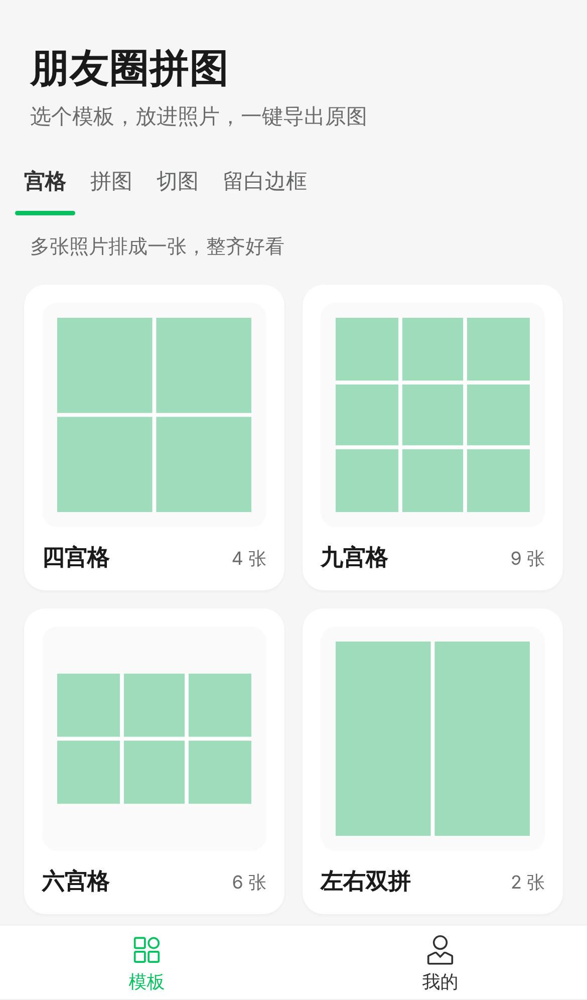
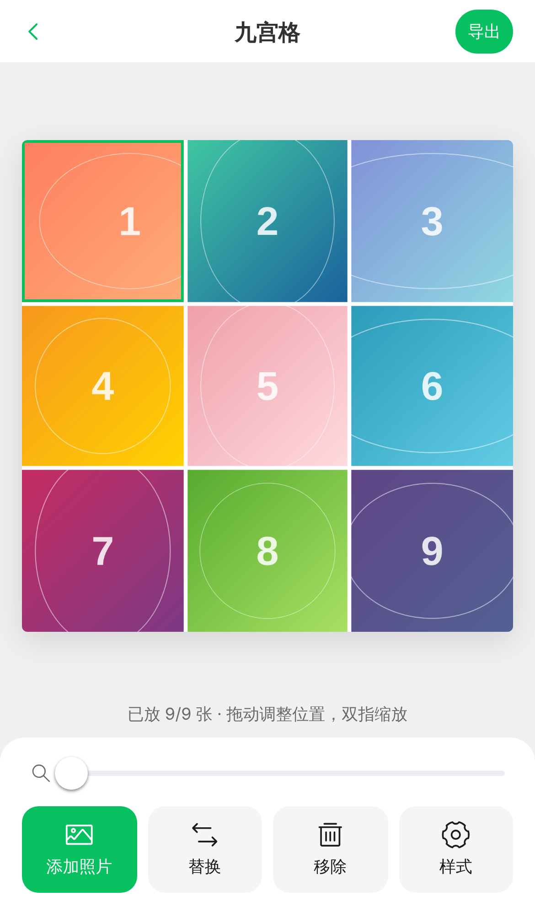
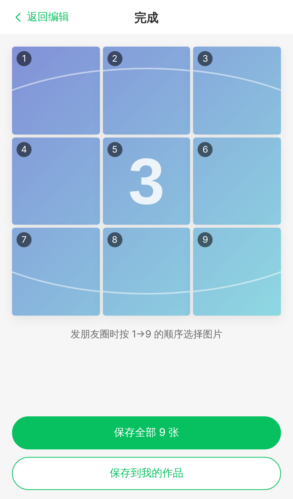
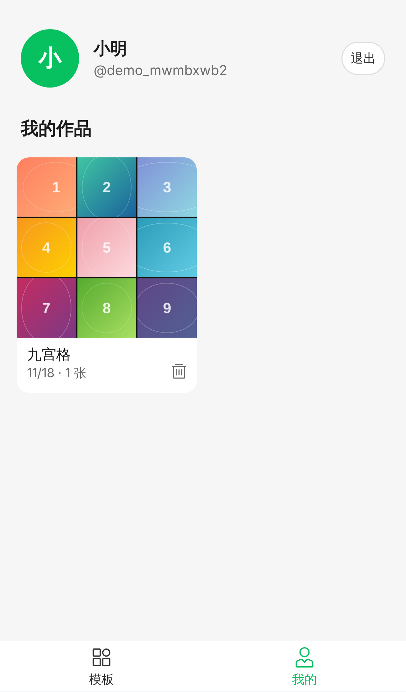

# 朋友圈拼图

把照片排成适合发朋友圈的格式：九宫格、拼图、九宫格切图、留白边框。用户在手机浏览器里选模板、放照片、拖动缩放调整，一键导出原图；登录后可以把作品保存到云端。

<p>
  
  
  
  
</p>

前后端分离的 pnpm monorepo：

| 目录 | 说明 | 技术栈 |
| --- | --- | --- |
| `apps/mobile` | 用户端 H5 / PWA，可"添加到主屏幕"像 App 一样使用 | Vue 3、Vite、TypeScript、Vant 4、Pinia、vite-plugin-pwa |
| `apps/server` | 服务端 API | NestJS 11、Prisma 6、PostgreSQL 16、JWT、Swagger、Pino |
| `apps/admin` | 运营后台（基于 vue-pure-admin，后续接入模板管理） | Vue 3、Element Plus |
| `packages/shared` | 前后端共享：模板 schema、布局计算、校验规则、内置模板 | TypeScript |

## 快速开始

需要 Node 20+、pnpm 10、PostgreSQL 16。

```bash
pnpm install

# 服务端
cp apps/server/.env.example apps/server/.env      # 按需修改数据库连接与密钥
pnpm --filter @moments/shared build
pnpm db:migrate                                   # 创建表结构
pnpm dev:server                                   # http://localhost:3000，接口文档 /api/docs

# 移动端（另开一个终端）
pnpm dev:mobile                                   # http://localhost:5173，/api 自动代理到 3000
```

首次启动时服务端会自动写入 16 个内置模板，并按 `ADMIN_USERNAME` / `ADMIN_PASSWORD` 创建管理员。

### Docker 一键部署

```bash
cp .env.example .env   # 修改密钥和管理员密码
docker compose up -d --build
# 访问 http://localhost:8080
```

`mobile` 容器用 Nginx 托管静态资源，并把 `/api`、`/uploads` 反向代理到 `server`；`server` 启动前自动执行数据库迁移。

## 架构说明

### 模板即数据

模板不是写死的页面，而是一份 JSON 定义（`TemplateDefinition`）：画布比例、导出宽度、若干归一化槽位（0~1 坐标）和样式（间距、边距、圆角、背景）。

- **layout** 类型：多张照片排进一张图（宫格、拼图、留白边框）。
- **split** 类型：一张照片切成多张，按顺序发布后在朋友圈拼回完整大图。

运营在后台新增模板只需提交一份定义，前端无需发版。定义的校验规则写在 `packages/shared/src/validate.ts`，服务端用它做入参校验，前端用它兜底，两端规则永远一致。

### 渲染在端上完成

照片不经过服务器处理：浏览器用 Canvas 按模板计算的像素矩形合成并导出 JPEG，隐私好、无服务端算力成本、离线也能用。布局计算（间距、cover 裁切、拖动、缩放）是纯函数，放在共享包里有单测覆盖；编辑器预览和导出走同一套渲染代码，所见即所得。

### 服务端分层

```
Controller（路由、参数校验、Swagger）
  → Service（业务规则）
    → PrismaService（数据访问） / StorageService（文件存储抽象）
```

横切能力集中在全局层：

- **鉴权**：全局 `JwtAuthGuard`，默认所有接口需要登录，`@Public()` 显式放开；`@Roles('ADMIN')` 做角色控制。Access token 2 小时、refresh token 7 天，登出时递增 `tokenVersion` 让所有 refresh token 失效。
- **统一响应**：成功 `{ code: 0, message, data, requestId }`，失败返回业务错误码（见 `error-codes.ts`），前端按 `code` 分支，不依赖文案；5xx 不向客户端暴露内部信息。
- **参数校验**：`class-validator` + `whitelist/forbidNonWhitelisted`，多余字段直接拒绝（防止越权写入 `role` 等字段）。
- **配置**：启动时用 zod 校验环境变量，生产环境禁止使用示例密钥。
- **可观测性**：Pino 结构化日志，透传或生成 `x-request-id`，日志自动脱敏 Authorization；`/api/v1/health/live`、`/api/v1/health/ready` 供容器编排探活。
- **安全**：Helmet、CORS 白名单、全局限流（登录注册更严格）、bcrypt 密码哈希、防用户名枚举；上传文件按文件头识别真实格式，拒绝伪装文件，存储 key 防目录穿越。
- **存储**：业务只依赖 `StorageService` 抽象，当前为本地磁盘实现，上线可替换为 OSS/COS/S3。

### 接口一览

| 方法 | 路径 | 说明 |
| --- | --- | --- |
| POST | `/api/v1/auth/register` `login` `refresh` `logout` | 账号 |
| GET | `/api/v1/users/me` | 当前用户 |
| GET | `/api/v1/templates`、`/templates/:idOrCode` | 已上架模板（公开） |
| GET/POST/PATCH/DELETE | `/api/v1/admin/templates` | 模板管理（管理员） |
| GET/POST/DELETE | `/api/v1/works` | 我的作品（上传导出图片） |
| GET | `/api/v1/health/live`、`/health/ready` | 健康检查 |

完整文档见开发环境的 Swagger：`http://localhost:3000/api/docs`。

## 测试

```bash
pnpm --filter @moments/shared test        # 布局计算与校验单测
pnpm --filter @moments/server test        # 服务端单测
pnpm --filter @moments/server test:e2e    # 服务端 e2e（需要 moments_test 数据库）
pnpm --filter @moments/mobile build       # 移动端类型检查与构建
```

CI（`.github/workflows/ci.yml`）在每个 PR 上启动 PostgreSQL 跑完以上全部检查。
